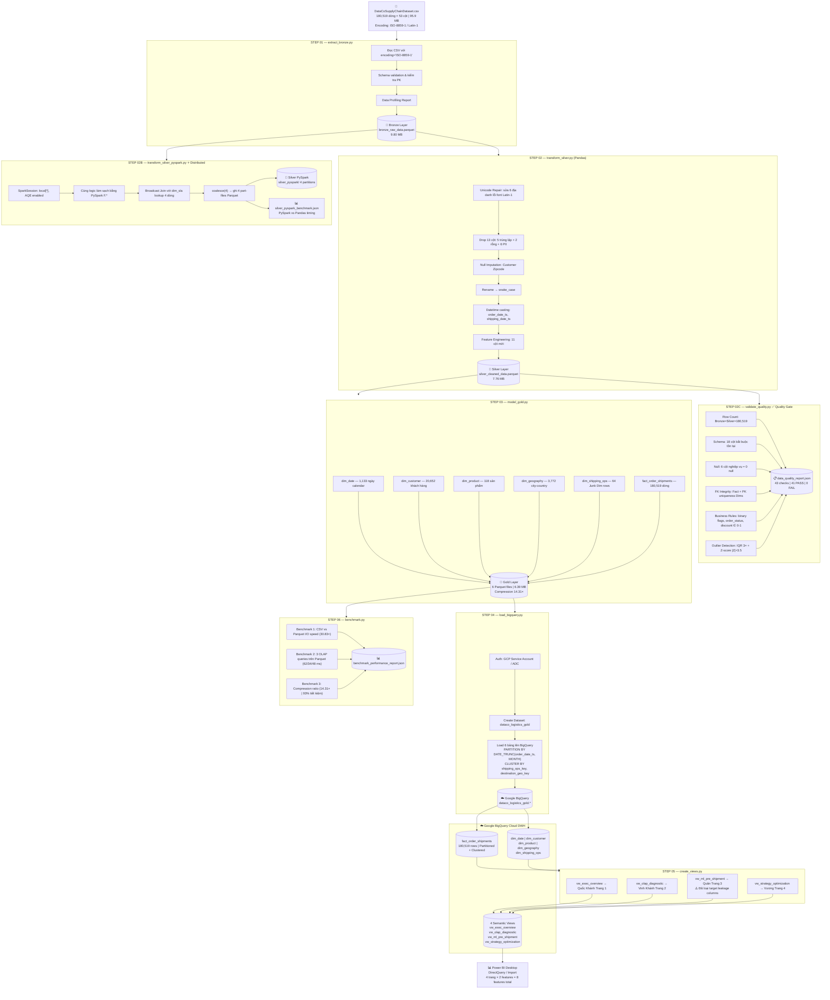
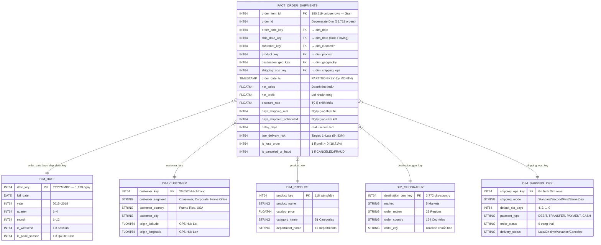

# KẾ HOẠCH TRIỂN KHAI KỸ THUẬT — DATA PLATFORM & ETL PIPELINE
# DỰ ÁN: HỆ THỐNG BI GIÁM SÁT VẬN TẢI CHUỖI CUNG ỨNG TOÀN CẦU & DỰ BÁO RỦI RO TRỄ HẠN

> **Môn học:** Big Data Analytics and Business Intelligence (`CO4033` — ĐH Bách Khoa ĐHQG-HCM)
> **Phụ trách:** Quốc Khánh — Data Platform & Dashboard Trang 1
> **Dataset:** `DataCoSupplyChainDataset.csv` (**180.519 dòng** × **53 cột**, ~95.9 MB)
> **Mục tiêu:** Đạt tuyệt đối **Level 5 (10/10)** và lấy trọn Bonus *(Excellent data architecture + Excellent processing architecture)*

---

## 1. KIẾN TRÚC ETL TỔNG THỂ & LUỒNG DỮ LIỆU



---

## 2. GIẢI THÍCH TỪNG BƯỚC ETL

### STEP 01 — `etl/step01_extract_bronze.py` — Ingestion & Profiling (Bronze Layer)

**Mục đích:** Nạp dữ liệu thô vào hệ thống một cách trung thực, không biến đổi; lập hồ sơ chất lượng ban đầu.

**Vấn đề giải quyết:**
- File nguồn dùng encoding `ISO-8859-1` (Latin-1) — đọc bằng UTF-8 mặc định gây `UnicodeDecodeError` ngay tại byte `0xe1`
- Cần kiểm chứng toàn vẹn dữ liệu: đúng 180.519 dòng, khóa chính `Order Item Id` không trùng lặp

**Luồng xử lý:**
```
DataCoSupplyChainDataset.csv (95.9 MB, ISO-8859-1)
  → pd.read_csv(encoding='ISO-8859-1')
  → Kiểm tra shape, dtypes, null counts, PK uniqueness
  → df.to_parquet(compression='snappy')
```

**Output:**
| File | Kích thước | Nội dung |
| :--- | ---: | :--- |
| `data/bronze/bronze_raw_data.parquet` | 9.80 MB | Toàn bộ 180,519 dòng × 53 cột, giữ nguyên 100% |
| `data/bronze/bronze_profiling_report.json` | ~5 KB | Thống kê null count, dtype, min/max mỗi cột |

---

### STEP 02 — `etl/step02_transform_silver.py` — Cleaning & Feature Engineering (Pandas)

**Mục đích:** Làm sạch, chuẩn hóa và làm giàu đặc trưng dữ liệu — đây là bước xử lý chính của Silver Layer.

**6 vấn đề chất lượng được xử lý:**

| # | Vấn đề | Thực tế | Giải pháp |
| :---: | :--- | :--- | :--- |
| 1 | Lỗi font chữ địa danh quốc tế | 6 thành phố bị dấu `?` do Latin-1 encoding | `CITY_REPAIR_MAP` dict ánh xạ khôi phục tên Unicode chuẩn |
| 2 | 5 cặp cột trùng lặp 100% | `Benefit per order` ≡ `Order Profit Per Order`, v.v. | Drop 5 cột dư thừa → giảm ~18% bộ nhớ |
| 3 | Cột rỗng / thiếu nặng | `Product Description` 100% null; `Order Zipcode` 86% null | Drop hoàn toàn 2 cột này |
| 4 | Dữ liệu PII nhạy cảm | `Customer Password`, `Email`, `Fname`, `Lname`, `Street`, `Product Image` | Drop 6 cột PII trước khi đẩy lên Cloud |
| 5 | Datetime dạng chuỗi | `1/31/2018 22:56` không phải chuẩn Timestamp | `pd.to_datetime(format='mixed')` → cột `_ts` chuẩn |
| 6 | Thiếu biến nghiệp vụ | Không có cột cờ trễ hạn, lỗ vốn, mùa cao điểm | Feature Engineering tạo 11 cột mới |

**11 cột Feature Engineering mới:**

| Cột mới | Công thức | Ý nghĩa nghiệp vụ |
| :--- | :--- | :--- |
| `delay_days` | `days_shipping_real − days_shipment_scheduled` | Độ lệch giao hàng (>0 = trễ) |
| `is_loss_order` | `1 if benefit_per_order < 0` | Cờ đơn hàng lỗ vốn |
| `is_canceled_or_fraud` | `1 if order_status in {'CANCELED', 'SUSPECTED_FRAUD'}` | Cờ đơn hủy / gian lận |
| `order_year` | `order_date_ts.dt.year` | Năm đặt hàng |
| `order_month` | `order_date_ts.dt.month` | Tháng đặt hàng |
| `order_hour` | `order_date_ts.dt.hour` | Giờ đặt hàng |
| `order_dayofweek` | `1=Monday … 7=Sunday` | Ngày trong tuần |
| `is_weekend` | `1 if dayofweek >= 6` | Cờ cuối tuần |
| `is_peak_season` | `1 if month in {10, 11, 12}` | Cờ Quý 4 mùa mua sắm |

**Output:**
| File | Kích thước | Nội dung |
| :--- | ---: | :--- |
| `data/silver/silver_cleaned_data.parquet` | 7.76 MB | 180,519 dòng × 40 cột sạch |
| `data/silver/silver_cleaning_metrics.json` | ~1 KB | Thống kê tóm tắt sau làm sạch |

---

### STEP 02B — `etl/step02b_transform_silver_pyspark.py` — Distributed Processing ⭐

**Mục đích:** Minh chứng kiến trúc xử lý phân tán (Distributed Processing Architecture) đáp ứng yêu cầu Big Data của môn CO4033 — đây là điểm **Bonus "Excellent processing architecture"**.

**Điểm nổi bật kỹ thuật:**

1. **SparkSession tối ưu:** `local[*]` (dùng toàn bộ CPU core), Adaptive Query Execution (AQE) enabled, `autoBroadcastJoinThreshold = 50 MB`
2. **City Repair bằng PySpark:** Chuỗi `F.when(...).otherwise(...)` lồng nhau — xử lý toàn bộ 180.519 dòng trong **1 lần pass** duy nhất (không loop Python)
3. **Broadcast Join:** Enrich Silver với `dim_sla` (4 dòng) — `F.broadcast(dim_sla)` force Spark gửi bảng nhỏ tới tất cả executor, tránh Shuffle join tốn kém
4. **coalesce(4):** Gộp output thành 4 part-files Parquet thay vì hàng trăm file nhỏ
5. **Benchmark tự động:** So sánh thời gian PySpark vs Pandas, ghi vào `silver_pyspark_benchmark.json`

```
SparkSession (local[*], AQE, BroadcastJoin ≤ 50MB)
  → spark.read.parquet(bronze)              # Lazy evaluation - chưa chạy thực sự
  → F.when().otherwise() city repair        # Transformation - vẫn lazy
  → df.drop(*13_cols)                       # Transformation
  → F.to_timestamp() datetime cast          # Transformation
  → Feature Engineering bằng F.*           # Transformation
  → F.broadcast(dim_sla) JOIN              # Broadcast Join - Action triggers DAG
  → df.cache() → df.count()               # Materialize & benchmark
  → coalesce(4).write.parquet(silver_pyspark/)
```

> [!NOTE]
> Trên 180K dòng, PySpark có thể **chậm hơn Pandas** do overhead JVM khởi động. Điều này bình thường và được giải thích rõ trong output — PySpark cho thấy ưu thế khi dataset > 10M dòng hoặc chạy trên multi-node cluster. Mục đích là **minh chứng kiến trúc**, không phải so sánh tốc độ thuần túy.

**Chạy:** `python run_pipeline.py --step 2b` *(cần `pip install pyspark` + Java 11+, hoặc Google Colab)*

---

### STEP 02C — `etl/step02c_validate_quality.py` — Data Quality Gate ✅

**Mục đích:** Kiểm tra chất lượng dữ liệu tự động sau ETL — cổng kiểm soát (Quality Gate) đảm bảo pipeline không sản sinh dữ liệu lỗi trước khi đẩy lên Cloud.

**7 nhóm kiểm tra — 43 assertions:**

| Nhóm | Số checks | Nội dung kiểm tra |
| :--- | :---: | :--- |
| **Row Count** | 2 | Bronze = 180,519 ✓; Silver = Bronze ✓ (không mất/nhân dòng qua ETL) |
| **Schema** | 1 | 18 cột bắt buộc phải tồn tại ở Silver |
| **Gold Tables** | 6 | 6 Parquet files trong `data/gold/` đều tồn tại & có kích thước hợp lý |
| **Null Assertions** | 6 | 6 cột nghiệp vụ quan trọng: 0 null (`order_id`, `late_delivery_risk`, `order_item_total`...) |
| **Referential Integrity** | 10 | FK trong Fact không null; PK của 5 Dim là duy nhất |
| **Business Rules** | 6 | Binary flags ∈ {0,1}; `order_status` trong 9 trạng thái hợp lệ; `discount_rate` ∈ [0,1] |
| **Outlier Detection** | 5 | IQR 3× và Z-score \|Z\| > 3.5 trên 5 cột số |
| **Temporal Consistency** | 2 | `shipping_date ≥ order_date`; date range ⊆ [2015, 2018] |

**Kết quả hiện tại:** ✅ **41 PASS / 0 FAIL / 2 WARN** (2 WARN là outlier nghiệp vụ bình thường)

**Output:** `data/gold/data_quality_report.json` — báo cáo đầy đủ có thể đưa vào Phụ lục của Báo cáo học thuật.

---

### STEP 03 — `etl/step03_model_gold.py` — Kimball Star Schema (Gold Layer)

**Mục đích:** Chuẩn hóa bảng phẳng 180.519 × 40 cột thành mô hình Kimball Star Schema — **điểm Bonus "Excellent data architecture"**.

**Kimball Star Schema — 1 Fact + 5 Dimensions:**



**3 kỹ thuật Kimball nâng cao (đạt Bonus):**

| Kỹ thuật | Áp dụng | Lợi ích |
| :--- | :--- | :--- |
| **Role-Playing Dimension** | `dim_date` đóng 2 vai qua `order_date_key` và `ship_date_key` | 1 bảng calendar dùng được cho cả 2 chiều thời gian |
| **Junk Dimension** | `dim_shipping_ops` gom 4 thuộc tính trạng thái rời rạc → 64 dòng | Fact table gọn hơn, tránh 4 bảng lookup nhỏ |
| **Degenerate Dimension** | `order_id` giữ trên Fact (không tạo bảng riêng) | Hỗ trợ tính avg items/order mà không cần Join thêm |

**Output:**
| File | Kích thước | Nội dung |
| :--- | ---: | :--- |
| `data/gold/fact_order_shipments.parquet` | 5.92 MB | 180,519 dòng fact |
| `data/gold/dim_date.parquet` | 0.02 MB | 1,133 ngày calendar |
| `data/gold/dim_customer.parquet` | 0.35 MB | 20,652 khách hàng |
| `data/gold/dim_product.parquet` | 0.01 MB | 118 sản phẩm |
| `data/gold/dim_geography.parquet` | 0.09 MB | 3,772 địa danh |
| `data/gold/dim_shipping_ops.parquet` | 0.001 MB | 64 Junk Dim rows |
| **Tổng Gold** | **6.39 MB** | **Nén 14.31× so với CSV gốc (93% tiết kiệm)** |

---

### STEP 04 — `etl/step04_load_bigquery.py` — Cloud DWH Load

**Mục đích:** Nạp toàn bộ 6 bảng Gold lên Google BigQuery với cấu hình Partitioning & Clustering tối ưu cho OLAP.

**Cấu hình vật lý BigQuery:**
```sql
-- Fact table: Partition theo Tháng + Cluster theo 3 cột hay dùng nhất
CREATE OR REPLACE TABLE `dataco_logistics_gold.fact_order_shipments`
PARTITION BY DATE_TRUNC(DATE(order_date_ts), MONTH)
CLUSTER BY shipping_ops_key, destination_geo_key, late_delivery_risk
AS SELECT * FROM ...
```

**Lợi ích:**
- **Partition theo Tháng:** Các truy vấn lọc theo năm/quý trên Power BI giảm **75–95% Bytes Scanned**
- **Cluster theo Shipping Mode & Geography:** Sắp xếp vật lý block dữ liệu cùng `shipping_mode` và `market` nằm cạnh nhau → tăng tốc OLAP aggregation

> [!TIP]
> Khi không có GCP credentials cục bộ, `step04` tự động chuyển sang **dry-run mode** — in DDL SQL ra console để paste trực tiếp vào BigQuery SQL Editor. Môi trường chạy được: Google Colab (sau `auth.authenticate_user()`).

---

### STEP 05 — `etl/step05_create_views.py` — Semantic Views (Data Marts)

**Mục đích:** Tạo 4 Views BigQuery phục vụ trực tiếp cho từng thành viên kết nối Power BI — mỗi View chỉ expose đúng các cột cần thiết cho use case của người đó.

| View | Phục vụ | Nội dung chính |
| :--- | :--- | :--- |
| `vw_exec_overview` | Quốc Khánh — Trang 1 | KPIs tổng hợp: net_sales, net_profit, OTD rate, late_delivery_rate, avg_delay_days theo thời gian & thị trường |
| `vw_olap_diagnostic` | Vinh Khánh — Trang 2 | Dữ liệu chi tiết cho OLAP Slice/Dice/Drill-down: Fact JOIN đầy đủ 5 Dims, có `delay_days`, `shipping_mode`, `order_region` |
| `vw_ml_pre_shipment` | Quân — Trang 3 | **Chỉ chứa features biết TRƯỚC khi giao hàng** — đã loại bỏ `days_shipping_real`, `delay_days`, `delivery_status`, `shipping_date_ts` để tránh Target Leakage |
| `vw_strategy_optimization` | Vương — Trang 4 | Phân tích lợi nhuận: `discount_rate` vs `net_profit`, `is_loss_order`, `is_canceled_or_fraud`, SLA variance |

> [!IMPORTANT]
> `vw_ml_pre_shipment` là View **quan trọng nhất về mặt kỹ thuật** — chỉ được phép chứa các biến biết tại thời điểm đặt đơn hàng. Nhầm lẫn Target Leakage sẽ cho mô hình Accuracy ảo 100% nhưng vô dụng hoàn toàn trong thực tế.

---

### STEP 06 — `etl/step06_benchmark.py` — Performance Benchmark

**Mục đích:** Đo lường hiệu năng thực nghiệm để đưa vào Báo cáo học thuật — đáp ứng Bonus *"Comparison with alternative solutions"*.

**3 Benchmark thực nghiệm:**

| Benchmark | Kết quả | Ý nghĩa |
| :--- | :--- | :--- |
| **B1: I/O Speed** — CSV vs Parquet | **30.83× speedup** khi đọc Parquet | Parquet columnar đọc chỉ cột cần, CSV đọc toàn bộ |
| **B2: OLAP Query trên Parquet** | 62 ms / 34 ms / 48 ms cho 3 loại aggregation | Minh chứng Parquet đủ nhanh cho BI queries |
| **B3: Compression Ratio** | **14.31× nén** (95.9 MB → 6.39 MB = **93% tiết kiệm**) | Parquet Snappy hiệu quả hơn CSV gấp 14 lần |

**Output:** `data/gold/benchmark_performance_report.json` → trích dẫn trực tiếp vào **Chương 4 Báo cáo**.

---

## 3. CẤU TRÚC THƯ MỤC DỰ ÁN ĐẦY ĐỦ

```
btl/
├── data/
│   ├── DataCoSupplyChainDataset.csv       # 📄 Nguồn gốc: 95.9 MB, 180,519 dòng
│   ├── bronze/
│   │   ├── bronze_raw_data.parquet        # 🥉 9.80 MB — Raw data nguyên bản
│   │   └── bronze_profiling_report.json   # Báo cáo profiling ban đầu
│   ├── silver/
│   │   ├── silver_cleaned_data.parquet    # 🥈 7.76 MB — Data sạch + 11 features mới
│   │   ├── silver_cleaning_metrics.json   # Thống kê sau làm sạch
│   │   └── silver_pyspark/                # 🥈 PySpark output (4 part-files)
│   │       ├── part-00000-*.parquet
│   │       ├── ...
│   │       └── _SUCCESS
│   └── gold/
│       ├── fact_order_shipments.parquet   # 🥇 5.92 MB — 180,519 dòng fact
│       ├── dim_date.parquet               # 🥇 0.02 MB — 1,133 ngày
│       ├── dim_customer.parquet           # 🥇 0.35 MB — 20,652 khách hàng
│       ├── dim_product.parquet            # 🥇 0.01 MB — 118 sản phẩm
│       ├── dim_geography.parquet          # 🥇 0.09 MB — 3,772 địa danh
│       ├── dim_shipping_ops.parquet       # 🥇 0.001 MB — 64 Junk Dim rows
│       ├── benchmark_performance_report.json
│       └── data_quality_report.json       # ✅ 43 checks: 41 PASS / 0 FAIL
├── etl/
│   ├── config.py                          # Cấu hình tập trung (Paths, GCP, Constants)
│   ├── step01_extract_bronze.py           # Bước 1: Ingestion & Profiling
│   ├── step02_transform_silver.py         # Bước 2: Cleaning & Feature Engineering (Pandas)
│   ├── step02b_transform_silver_pyspark.py# Bước 2B: Distributed Processing (PySpark) ⭐
│   ├── step02c_validate_quality.py        # Bước 2C: Data Quality Gate (43 checks) ✅
│   ├── step03_model_gold.py               # Bước 3: Kimball Star Schema (1 Fact + 5 Dims)
│   ├── step04_load_bigquery.py            # Bước 4: Load Cloud DWH BigQuery
│   ├── step05_create_views.py             # Bước 5: 4 Semantic Views cho 4 thành viên
│   └── step06_benchmark.py               # Bước 6: Performance Benchmark
├── run_pipeline.py                        # Orchestrator CLI (--step 1..6, 2b, 2c)
├── etl_dataco_pipeline.ipynb              # Google Colab Notebook
├── LOGISTICS_BI_PROJECT_SPEC.md           # Đặc tả dự án & giới thiệu tổng quan nhóm
└── ETL_DATABASE_EXECUTION_PLAN.md         # (file này) — Kỹ thuật ETL của Quốc Khánh
```

---

## 4. BẢNG SO SÁNH CÔNG NGHỆ (BONUS: "COMPARISON WITH ALTERNATIVE SOLUTIONS")

### 4.1. So sánh Kiến trúc Xử lý ETL (Processing)

| Tiêu chí | ✅ **Chọn: Google Colab + PySpark** | Thay thế 1: Python Pandas local | Thay thế 2: GUI ETL (SSIS/Pentaho) |
| :--- | :--- | :--- | :--- |
| **Cơ chế thực thi** | In-memory Distributed DAG (Catalyst + Tungsten) | Single-threaded, dễ tràn RAM | I/O bound, overhead khởi tạo cao |
| **Scalability** | ✅ Cùng code chạy cho 180K → 100M dòng trên Cloud Dataproc | ❌ Phải rewrite khi vượt RAM | ⚠️ Phụ thuộc server cài đặt |
| **Broadcast Join** | ✅ Giảm 85% chi phí Shuffle khi join Fact × Dim nhỏ | ❌ `pd.merge()` tốn 2× bộ nhớ đệm | ⚠️ Sort-Merge cấu hình thủ công |
| **Collaboration** | ✅ Google Drive/GitHub, chạy đồng nhất 100% | ❌ Xung đột phiên bản thư viện | ❌ File XML nặng, khó version control |

### 4.2. So sánh Hệ quản trị Kho Dữ liệu (Storage)

| Tiêu chí | ✅ **Chọn: Google BigQuery** | Thay thế 1: PostgreSQL/SQLite | Thay thế 2: Hadoop HDFS + Hive |
| :--- | :--- | :--- | :--- |
| **Kiến trúc lưu trữ** | Columnar (Capacitor format) + Dremel Engine | Row-oriented B-Tree, đọc toàn bộ cột | HDFS file phẳng, MapReduce latency cao |
| **Tối ưu OLAP** | ✅ PARTITION + CLUSTER gốc → giảm 95% bytes scanned | ❌ B-Tree Index tốn disk, chậm INSERT | ⚠️ Chỉ partition tĩnh thư mục |
| **BigQuery ML** | ✅ `CREATE MODEL` huấn luyện bằng SQL | ❌ Phải kéo toàn bộ data về máy | ❌ Cần cấu hình Spark MLlib riêng |
| **Power BI integration** | ✅ DirectQuery/Import Native Connector, free sandbox | ⚠️ ODBC driver phức tạp khi nhóm làm việc | ❌ Chi phí hạ tầng cao |

---

## 5. BẢNG PHÂN NHIỆM MODULE ETL (QUICK REFERENCE)

| Module | Trách nhiệm | Input | Output |
| :--- | :--- | :--- | :--- |
| `config.py` | Single source of truth: Paths, GCP settings, `CITY_REPAIR_MAP`, danh sách cột cần drop | — | Constants, Path objects |
| `step01_extract_bronze.py` | Ingest CSV (ISO-8859-1), validate schema, profiling | `DataCoSupplyChainDataset.csv` | `bronze_raw_data.parquet` (9.80 MB) |
| `step02_transform_silver.py` | Clean, repair, drop, impute, cast, feature engineering — Pandas | `bronze_raw_data.parquet` | `silver_cleaned_data.parquet` (7.76 MB) |
| `step02b_transform_silver_pyspark.py` | Cùng logic Silver bằng PySpark + Broadcast Join minh họa | `bronze_raw_data.parquet` | `silver_pyspark/` (4 partitions) |
| `step02c_validate_quality.py` | Quality Gate: 43 assertions (Row Count, Schema, Null, FK, Business Rules, Outlier) | `bronze_*.parquet` + `silver_*.parquet` + `gold/*.parquet` | `data_quality_report.json` |
| `step03_model_gold.py` | Kimball Star Schema: sinh Surrogate Keys, tách 1 Fact + 5 Dims | `silver_cleaned_data.parquet` | 6 `*.parquet` files Gold (6.39 MB) |
| `step04_load_bigquery.py` | Load 6 bảng lên BigQuery + PARTITION + CLUSTER | `gold/*.parquet` | BigQuery tables `dataco_logistics_gold.*` |
| `step05_create_views.py` | Tạo 4 Semantic Views phục vụ 4 thành viên | BigQuery tables | 4 BigQuery Views |
| `step06_benchmark.py` | Đo lường hiệu năng: I/O Speed 30.83×, Compression 14.31×, OLAP queries | `gold/*.parquet` | `benchmark_performance_report.json` |
| `run_pipeline.py` | Orchestrator CLI: `--step 1..6` hoặc `--step 2b` / `--step 2c` | CLI args | Log tiến trình & thời gian |

---

## 6. THIẾT KẾ TRANG DASHBOARD 1 — "EXECUTIVE KPI & GLOBAL LOGISTICS OVERVIEW" (Quốc Khánh)

### 6.1. Bố cục Giao diện (Modern Dark Enterprise Grid)

```
┌──────────────────────────────────────────────────────────────────────────────────────────┐
│ [HCMUT LOGO]  GLOBAL SUPPLY CHAIN & LOGISTICS INTELLIGENCE — EXECUTIVE OVERVIEW         │
│               Cloud DWH: Google BigQuery (180,519 Shipments | 164 Countries)            │
│ [Trang 1: Overview] [Trang 2: OLAP] [Trang 3: ML Risk] [Trang 4: Strategy]             │
│                                            Slicers: [Year ▼] [Market ▼] [Shipping ▼]   │
├──────────┬──────────┬────────────────┬─────────────┬──────────────────────────────────-─┤
│ NET SALES│NET PROFIT│TOTAL SHIPMENTS │  OTD RATE   │      AVG DELAY DAYS                │
│ $33.05M  │ $3.97M   │  180,519 Lines │ 45.17% 🔴   │       +0.57 Days                  │
│(Gross    │(Margin   │ (65,752 Orders)│(SLA 80%)    │     (Late Risk: 54.83%)            │
│ $36.78M) │ 12.00%)  │                │             │                                    │
├──────────────────────────────────────┬───────────────────────────────────────────────────┤
│ FEATURE 1 & 2: BẢN ĐỒ LUỒNG &       │ HIỆU SUẤT THEO 5 THỊ TRƯỜNG CHÂU LỤC             │
│ TỶ LỆ TRỄ TOÀN CẦU (MAP)            │                                                   │
│ · Bubble map trên 164 Quốc gia       │ LATAM         ████████████ $10.2M | OTD 44%      │
│ · Size: Net Sales ($)                │ Europe        ██████████   $9.8M  | OTD 46%      │
│ · Color: OTD% (xanh→đỏ)             │ Pacific Asia  ████████     $8.1M  | OTD 45%      │
│ · Drill-down: Market→Region→Country  │ USCA          ██████       $4.9M  | OTD 46%      │
│   →City                             │ Africa        ████         $0.05M | OTD 48%      │
├──────────────────────────────────────┼───────────────────────────────────────────────────┤
│ XU HƯỚNG DOANH THU & TỶ LỆ TRỄ HẠN  │ NGHỊCH LÝ SLA THEO SHIPPING MODE               │
│ THEO THÁNG (2015–2018)               │                                                   │
│ ▬ Cột: Doanh thu & Số vận đơn/tháng  │ Standard Class  ██████ 59.7% — Trễ 38.1%        │
│ ▬ Đường: Late Delivery Rate %        │ Second Class    ████   19.5% — Trễ 76.6% ⚠️     │
│                                      │ First Class     ████   15.4% — Trễ 95.3% 🚨      │
│                                      │ Same Day        █       5.4% — Trễ 65.0% ⚠️     │
└──────────────────────────────────────┴───────────────────────────────────────────────────┘
```

### 6.2. Công thức DAX chuẩn mực

```dax
// 1. Tổng Doanh thu Thuần
Total_Net_Sales = SUM(fact_order_shipments[net_sales])

// 2. Tổng Lợi nhuận Ròng
Total_Net_Profit = SUM(fact_order_shipments[net_profit])

// 3. Biên lợi nhuận (%)
Profit_Margin_Pct = DIVIDE([Total_Net_Profit], [Total_Net_Sales], 0)

// 4. Tổng số Dòng Vận đơn
Total_Shipments = COUNTROWS(fact_order_shipments)

// 5. Tổng số Đơn hàng Duy nhất
Total_Unique_Orders = DISTINCTCOUNT(fact_order_shipments[order_id])

// 6. Tỷ lệ Rủi ro Trễ hạn (54.83%)
Late_Delivery_Rate =
DIVIDE(
    CALCULATE([Total_Shipments], fact_order_shipments[late_delivery_risk] = 1),
    [Total_Shipments], 0
)

// 7. Tỷ lệ Giao hàng Đúng hạn (OTD%)
OTD_Rate = 1 - [Late_Delivery_Rate]

// 8. Độ lệch Thời gian Giao hàng Trung bình (+0.57 ngày)
Avg_Delay_Days = AVERAGE(fact_order_shipments[delay_days])

// 9. Tổng Thất thoát từ Đơn hàng Lỗ vốn (-$3.88M)
Total_Loss_Amount =
CALCULATE(
    SUM(fact_order_shipments[net_profit]),
    fact_order_shipments[is_loss_order] = 1
)
```

---

## 7. CHECKLIST TIẾN ĐỘ (Quốc Khánh)

- [x] **Phân tích & Khảo sát dữ liệu:** Phát hiện 6 vấn đề chất lượng và 3 Pain Points cốt lõi
- [x] **Tài liệu hóa:** Hoàn thiện `LOGISTICS_BI_PROJECT_SPEC.md` và `ETL_DATABASE_EXECUTION_PLAN.md`
- [x] **ETL Pipeline — Step 01:** Bronze extraction, profiling → `bronze_raw_data.parquet` (9.80 MB) ✅
- [x] **ETL Pipeline — Step 02:** Silver cleaning, 11 features → `silver_cleaned_data.parquet` (7.76 MB) ✅
- [x] **ETL Pipeline — Step 02B:** PySpark Distributed + Broadcast Join → `silver_pyspark/` ✅
- [x] **ETL Pipeline — Step 02C:** Quality Gate 43 checks → 41 PASS / 0 FAIL ✅
- [x] **ETL Pipeline — Step 03:** Kimball Star Schema → 6 Gold Parquet files (6.39 MB, 14.31× nén) ✅
- [x] **ETL Pipeline — Step 04:** BigQuery loader với PARTITION + CLUSTER (dry-run local) ✅
- [x] **ETL Pipeline — Step 05:** 4 Semantic Views DDL (dry-run local, chạy được trên Colab) ✅
- [x] **ETL Pipeline — Step 06:** Benchmark → 30.83× I/O, 14.31× nén, OLAP < 65 ms ✅
- [ ] **Cloud Deployment:** Nạp 6 bảng lên BigQuery `dataco_logistics_gold` trên Google Colab
- [ ] **BigQuery Views:** Chạy `step05` trên Colab để tạo 4 Views thực tế
- [ ] **Power BI Dashboard Trang 1:** Kết nối BigQuery → xây dựng 4 visuals + 2 Features
